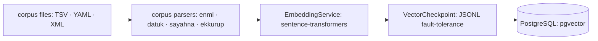
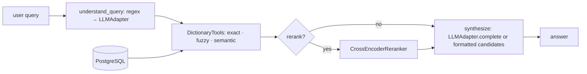
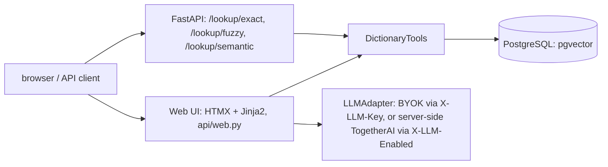
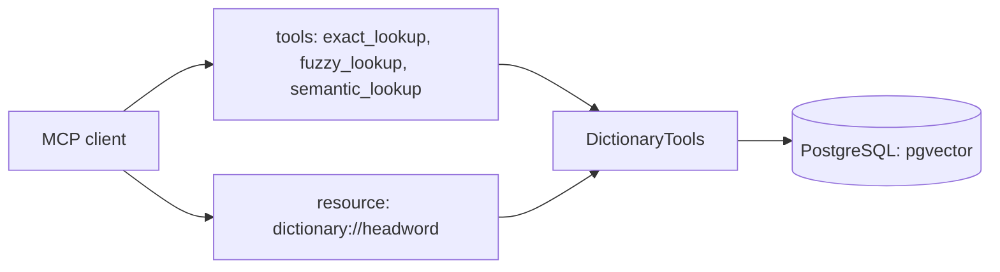
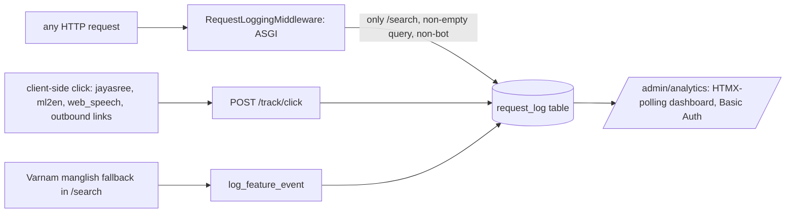

# Architecture

Five independent subsystems share the same Postgres + pgvector database:
the **ingestion pipeline**, the **RAG pipeline**, the **REST API / web UI**, the **MCP server**, and **observability**.

Four corpora are active: **Olam** (EN→ML), **Datuk** (ML→ML), **Shabdataaravali / Sayahna** (ML→ML, classical 1917 dictionary), and **Ekkurup** (EN→ML thesaurus). Each corpus is wired via a `parser._target_` entry in `config/corpus/all.yaml`; no Python code change is needed to add a new corpus.

---

## Ingestion



Checkpoint-based — restarts safely after a crash without re-embedding already-vectorised entries.

---

## RAG pipeline



`understand_query` tries regex patterns first and only calls the LLM adapter for unrecognised phrasings.
When `llm=nollm`, synthesis skips the LLM and returns formatted top-k candidates directly.

**Fuzzy matching** (`DictionaryTools.fuzzy_lookup()`) tries the query's mlmorph lemma first —
catches inflected forms (e.g. എഴുതുന്നു → എഴുതുക) no string-similarity metric reliably
retrieves — then falls back to normalized Levenshtein edit distance for genuine typos.
Not pg_trgm trigram similarity: trigram's similarity ratio is length-biased (a fixed-size
typo costs a much bigger fraction of a short word's trigram set), which silently hid real
typos on short words below the confidence bar. Confirmed empirically before switching —
see `notebooks/malayalam_fuzzy_matching_research.ipynb` and
`notebooks/fuzzy_vs_edit_retrieval_quality.ipynb`.

---

## REST API and web UI



The web UI calls `DictionaryTools` directly (the same singleton the REST `/lookup/*` endpoints use) — it never
makes an internal HTTP call to `/lookup/*`; the two are independent consumers of the same tools object, not
layered on top of each other.

Deployed at [linguaalayam.org](https://linguaalayam.org) — Google Cloud Run (the app, scale-to-zero), connecting over
Direct VPC egress + Cloud NAT to **Postgres on the original Hetzner VPS**, which stays as-is. A dormant Hetzner
copy of the app itself is kept as a manual rollback path (see `.github/workflows/cd.yml`), not serving traffic.
See `terraform/RUNBOOK.md` for the full Terraform-managed infra and its safe-apply policy.
LLM synthesis has two paths: bring-your-own-key (`X-LLM-Key` header, any of Anthropic/OpenAI/TogetherAI, never
persisted server-side), or a free server-side default (`X-LLM-Enabled: 1`, TogetherAI Qwen 3.5 9B, no user key
needed — see `_get_server_llm()` in `api/web.py`).

---

## MCP server



No LLM involvement — pure retrieval. The production `/mcp` server is mounted inside the FastAPI
app (`mcp/remote.py`) and shares `DictionaryTools` with the REST API — same `LazyEmbeddingService`
background-load as the web app (see `api/app.py`'s `_lifespan`), so a `semantic_lookup` call arriving
before that finishes blocks per-request rather than waiting on a model "loaded once at startup."
The standalone `poetry run mcp-server` process (`mcp/server.py`, local/bare-metal use) is unaffected —
it still builds a real `EmbeddingService` synchronously at its own startup.

---

## Observability



Every inbound request is *classified* into a `route_type` (`web_search`, `lookup_*`, `mcp`, `mcp_setup_page`, `api_docs`, `outbound_click`, `jayasree`, `ml2en`, `web_speech`, `varnam`, …), but only a `/search` request with a non-empty `query` from a non-bot client is actually written to `request_log` — everything else (static assets, API docs, health probes, MCP traffic, empty typing, bots/scrapers) is intentionally not persisted; the owner cares about where actual dictionary searches come from, not every HTTP hit. Client-side interactions with no server route of their own (or that would otherwise be misclassified, like a romanise-toggle re-triggering `/search`) are reported via a `sendBeacon` to `POST /track/click`, validated against a label allow-list. The dashboard at `/admin/analytics` is gated by HTTP Basic Auth and never publicly linked.

City/region/country come from a local MaxMind GeoLite2-City lookup (`observability/geoip.py`), not a Cloudflare header — Cloud Run has no equivalent of `CF-IPCountry`/`CF-Connecting-IP` since Cloudflare no longer proxies the production hostnames. The `.mmdb` database is baked into the Docker image at build time (see `Dockerfile`); `scripts/backfill_geoip.py` retroactively resolves location for rows logged before this existed.

---

## Module reference

| Module | Purpose |
|---|---|
| `linguaalayam/models/entries.py` | Entry types (`OlamEntry`, `DatukEntry`, `SayahnaEntry`, `EkkurupEntry`), each with `to_embed_text()` |
| `linguaalayam/models/orm.py` | SQLAlchemy `DictionaryEntry` ORM — headword, embed_text, JSONB data, Vector(768) |
| `linguaalayam/corpus/base.py` | `parse_definition_tsv()` — shared 3-column TSV helper used by `enml.py` and `datuk.py` |
| `linguaalayam/corpus/` | One parser per corpus (`enml.py`, `datuk.py`, `sayahna.py`, `ekkurup.py`), each exposes `parse()` |
| `linguaalayam/embeddings/service.py` | `EmbeddingService` — wraps sentence-transformers, exposes `batch_size` and `vector_size` |
| `linguaalayam/database/queries.py` | `batch_insert()`, `similarity_search()` (HNSW cosine), `get_ingested_headwords()`; all search functions accept `source: str \| list[str] \| None` |
| `linguaalayam/llm/adapters/` | `LLMAdapter` ABC + `AnthropicAdapter`, `OpenAIAdapter`, `TogetherAIAdapter` (Qwen 3.5 9B via TogetherAI), `NoLLMAdapter`. All accept optional `api_key` kwarg; fall back to env vars (`ANTHROPIC_API_KEY`, `OPENAI_API_KEY`, `TOGETHER_API_KEY`). |
| `linguaalayam/rag/pipeline.py` | LangGraph graph: understand → retrieve → rerank? → synthesize |
| `linguaalayam/rag/query_understanding.py` | `understand_query()` — regex patterns first, LLM fallback for unrecognised phrasings |
| `linguaalayam/rag/reranker.py` | `CrossEncoderReranker` — optional cross-encoder reranking step in the RAG pipeline |
| `linguaalayam/rag/tools.py` | `DictionaryTools` — exact, fuzzy, semantic lookup over a live DB session |
| `linguaalayam/mcp/server.py` | Standalone FastMCP server (stdio) — three tools + `dictionary://{headword}` resource; used by local/CLI clients |
| `linguaalayam/mcp/remote.py` | Production MCP server mounted inside the FastAPI app at `/mcp` — shares `DictionaryTools`/the lazy embedding service with the REST API and web UI (no second DB connection or model load); OAuth passthrough, dynamic client registration |
| `linguaalayam/mcp/shared.py` | `format_results()` — shared plain-text formatting used by both MCP server variants |
| `linguaalayam/api/web.py` | HTMX web UI routes (`/`, `/search`, `/settings`, `/privacy`, `/mcp/setup`) — the largest, most-changed module; owns query understanding, Manglish/Varnam fallback, AI Answer synthesis (including phrase decomposition), and template rendering |
| `linguaalayam/api/app.py` | FastAPI app factory — lifespan setup (DB engine, lazy embedding service, translator), mounts the web router, REST `/lookup/*` endpoints, and the MCP server |
| `linguaalayam/api/dependencies.py` | `get_tools()` / `get_translator()` / `get_session_factory()` — shared singletons injected into routes |
| `linguaalayam/api/oauth.py` | `PassthroughOAuthProvider` — OAuth 2.0 authorization server for the Claude.ai browser connector (dynamic client registration, PKCE) |
| `linguaalayam/database/session.py` | `get_session()` — context-managed DB session helper used across routes and scripts |
| `linguaalayam/eval/` | Evaluation harness — `eval-retrieval` (CI-wired, retrieval-only metrics: hit@1, hit@k, MRR, tool attribution) plus standalone tooling for preparing eval datasets and comparing embedding models (`eval-prepare-corpus`, `eval-prepare-queries`, `eval-embedding`); LLM answer/grounding quality is not covered here |
| `linguaalayam/scripts/ingest.py` | Ingestion entry point; corpus parsers injected via Hydra `_target_` — no hardcoded parser map |
| `linguaalayam/translation/` | `TranslationService` ABC + `NoOpTranslationService` (default) and `MarianTranslationService` (Helsinki-NLP/opus-mt-mul-en, disabled by default — unreliable across several languages, not just one family, see docs/roadmap.md's backlog). Backend selected via `TRANSLATION_BACKEND` env var in `build_translation_service()`. Built in `app.py` lifespan, exposed through `get_translator()` in `api/dependencies.py`. |
| `linguaalayam/templates/` | Jinja2 templates served by the web router (`api/web.py`). `base.html` provides the shared layout with i18n helpers. `index.html` is the main search page (HTMX-driven). `partials/results.html` renders search results and AI answers. User API keys and AI-synthesis/language preferences live in the settings sidebar in `base.html` (`/settings` just redirects to `/?settings=1` to open it — no standalone template). All CSS is inline per-template — no external stylesheets. HTMX partials are returned from `/search` and re-render `#results`. |
| `linguaalayam/transliteration/core.py` | `is_latin_script()`, `malayalam_to_roman()`, `normalize_roman()`, `roman_to_malayalam_candidates()` — formal romanisation schemes |
| `linguaalayam/transliteration/morphology.py` | `analyse_word()` — mlmorph-based Malayalam morphological analyser; LRU-cached, handles archaic chillu normalisation; computed once at ingest time and stored on `DatukEntry`/`SayahnaEntry` |
| `linguaalayam/transliteration/varnam.py` | `manglish_to_malayalam()` — Varnam API client for informal Manglish transliteration; falls back to `core.roman_to_malayalam_candidates()` when unavailable |
| `linguaalayam/env.py` | Centralised env loader; reads secrets from Windows Credential Manager on WSL, falls back to `.env` |
| `linguaalayam/observability/` | `RequestLog` ORM model, `RequestLoggingMiddleware` (ASGI), `log_feature_event()`, `geoip.py` (local MaxMind city/region/country lookup), and query helpers backing `/admin/analytics` |
| `linguaalayam/scripts/backfill_geoip.py` | One-off: resolves city/region on `request_log` rows logged before the GeoIP lookup existed |
| `linguaalayam/api/admin.py` | `/admin/analytics` dashboard + HTMX partial, HTTP Basic Auth via `ADMIN_USER`/`ADMIN_PASSWORD` |
| `linguaalayam/static/vendor/jayasree/` | Vendored from the [`jayasree`](https://github.com/sachn1/jayasree) npm package by `scripts/sync_jayasree.sh` (`make sync-jayasree`); not committed — regenerated at build time from `package.json`. Powers the per-word handwriting trace button on Malayalam headwords, lazy-loaded client-side |
| `config/` | Hydra config groups: `corpus` (with per-source `parser._target_`), `embedding`, `database`, `llm`, `rag` |
| `migrations/` | Alembic schema migrations |

---

## Tech stack

| Layer | Choice |
|---|---|
| Language | Python 3.11+ |
| DB | PostgreSQL + pgvector (local Docker) |
| ORM / migrations | SQLAlchemy 2.0, Alembic |
| Embeddings | sentence-transformers (`paraphrase-multilingual-mpnet-base-v2`) |
| RAG graph | LangGraph + LangChain |
| LLM | TogetherAI (Qwen 3.5 9B) default; Anthropic Claude, OpenAI via `LLMAdapter`; `NoLLMAdapter` for zero-key usage |
| REST API / Web UI | FastAPI, HTMX, Jinja2 |
| MCP | FastMCP (`mcp` SDK) |
| Deployment | Google Cloud Run (app, scale-to-zero) + Terraform; Postgres stays on Hetzner CX33, reached via Direct VPC egress + Cloud NAT |
| Config | Hydra |
| Testing | pytest, ruff, pre-commit |

---

## API examples

Query understanding — regex-based, no external dependencies:

```python
from linguaalayam.rag.query_understanding import understand_query

result = understand_query("define serendipity")
assert result.headword == "serendipity"
assert result.intent == "define"

result = understand_query("translate water to malayalam")
assert result.intent == "translate"
```

LLM adapters — the `NoLLMAdapter` needs no API key:

```python
from linguaalayam.llm.adapters.nollm import NoLLMAdapter

adapter = NoLLMAdapter()
assert not adapter.has_llm
```

Entry text representations:

```python
from linguaalayam.models.entries import OlamEntry, DatukEntry, SayahnaEntry, EkkurupEntry, EkkurupSense

entry = OlamEntry(headword="run", definitions=[("v", "ഓടുക")])
text = entry.to_embed_text()
assert text.startswith("word: run")
assert "ഓടുക" in text

ml_entry = DatukEntry(headword="ഓടുക", definitions=[("v", "വേഗത്തിൽ ചലിക്കുക")])
ml_text = ml_entry.to_embed_text()
assert "ഓടുക" in ml_text

say_entry = SayahnaEntry(headword="അംശം", definitions=[(None, "ഭാഗം")], explanations=["സ്ത്രീ: അംശിനി."])
say_text = say_entry.to_embed_text()
assert "അംശം" in say_text
assert "notes:" in say_text

ek_entry = EkkurupEntry(
    headword="run",
    senses=[EkkurupSense(pos="verb", en=[["sprint", "dash"]], ml=[["ഓടുക"]])],
)
ek_text = ek_entry.to_embed_text()
assert "[verb]" in ek_text
assert "sprint" in ek_text
assert "ഓടുക" in ek_text
```
